<picture>
  <source media="(max-width: 520px) and (prefers-color-scheme: dark)" srcset="assets/header-mobile-dark.svg" />
  <source media="(max-width: 520px) and (prefers-color-scheme: light)" srcset="assets/header-mobile-light.svg" />
  <source media="(prefers-color-scheme: dark)" srcset="assets/header-dark.svg" />
  <source media="(prefers-color-scheme: light)" srcset="assets/header-light.svg" />
  
</picture>

<p align="center">
  <a href="https://kunalagarawal.vercel.app/">
    
  </a>
  <a href="https://www.linkedin.com/in/kunal-r6/">
    
  </a>
  <a href="mailto:kunalkunal63@gmail.com">
    
  </a>
  <a href="https://drive.google.com/file/d/1Aw6KtOZdKzJP9aORcOHwPvyKZkWzcfZx/view?usp=drive_link">
    
  </a>
  <a href="https://drive.google.com/file/d/1u2NoEQygw5iVl_k_af0xoAMGgW5CaJ7y/view?usp=sharing">
    
  </a>
</p>

I write Rust for trading systems, Linux networking and Solana infrastructure.

My main project is [Outcomia](https://github.com/kunal171/outcomia), an on-chain order book for prediction markets and spot trading. I also work on a native matching engine and an authenticated Linux VPN. The interesting work is usually in recovery, replay and the edges between components.

## Open-source contributions

- **[Digital Asset DPM — merged PR #341](https://github.com/digital-asset/dpm/pull/341)**: Fixed local DAR dependency paths breaking in folders with spaces. Added regression tests for special characters, Unicode and Windows-style paths.

## Selected systems

| Project | Engineering focus |
|---|---|
| **[Outcomia](https://github.com/kunal171/outcomia)** | CLOB-based prediction markets and spot trading on Solana, with collateralized orders, price-level FIFO queues, bounded atomic matching, resolution and redemption, fee accounting, a Next.js client, and a Rust indexer |
| **[HFT Limit Order Book](https://github.com/kunal171/hft-limit-order-book)** | Deterministic price-time matching, O(1) cancellation, replayable events, simulation, benchmarks, and a PostgreSQL control plane | 
| **[Rust VPN](https://github.com/kunal171/rust_vpn)** | Linux TUN over UDP with X25519, Ed25519, ChaCha20-Poly1305, replay protection, routing, DNS handling, and cleanup |
| **[Subdex](https://github.com/kunal171/subdex)** | Code-first Substrate indexer for chain ingestion and backend data pipelines | 
| **[Distributed Queue](https://github.com/kunal171/distributed_queue)** | TCP message broker with multiple producers and consumers and at-least-once delivery | 
| **[Raft Consensus](https://github.com/kunal171/raft_consensus)** | Leader election, replication, and consensus experiments in Rust | 

<details>
<summary><strong>Earlier backend projects</strong></summary>

- [gRPC task service](https://github.com/kunal171/grpc_service) — unary, server-streaming, and bidirectional Tonic RPCs.
- [URL shortener](https://github.com/kunal171/url_shortner) — Axum, Tokio, MongoDB, validation, redirects, and visit statistics.
- [Redis clone](https://github.com/kunal171/redis_clone) — RESP parsing and an asynchronous in-memory store.
- [Mini blockchain](https://github.com/kunal171/blockchain) — blockchain fundamentals over a peer-to-peer gossip network.

</details>

## Systems toolbox

| Area | Tools and concepts |
|---|---|
| Rust backend | Rust, Tokio, Axum, Actix Web, Tonic/gRPC, channels, structured errors |
| Trading systems | Price-time priority, order books, integer arithmetic, event replay, simulation, latency measurement |
| Networking | TCP/UDP, Linux TUN, routing, network namespaces, DNS, packet validation |
| Cryptography | X25519, Ed25519, ChaCha20-Poly1305, authenticated encryption, replay protection |
| Blockchain | Solana, Anchor, Substrate, Polkadot, smart contracts, event indexers |
| Data and operations | PostgreSQL, MongoDB, Redis, Docker, GitHub Actions, metrics and tracing |

<p align="center">
  
</p>

## What I am building now

```text
Outcomia                         Native Rust matching engine
   │                                         │
   ├─ finalized event ingestion              ├─ sequenced runtime
   ├─ indexed market state                   ├─ API integration
   ├─ query API                              ├─ persistence and replay
   └─ live order-book views                  └─ latency benchmarks
```

The two tracks study the same problem from different constraints: Outcomia must fit Solana's account and transaction model, while the native engine can optimize an in-memory single-writer hot path.

## A little systems magic

<picture>
  <source media="(max-width: 520px) and (prefers-color-scheme: dark)" srcset="assets/systems-alchemy-mobile-dark.svg" />
  <source media="(max-width: 520px) and (prefers-color-scheme: light)" srcset="assets/systems-alchemy-mobile-light.svg" />
  <source media="(prefers-color-scheme: dark)" srcset="assets/systems-alchemy-dark.svg" />
  <source media="(prefers-color-scheme: light)" srcset="assets/systems-alchemy-light.svg" />
  
</picture>
